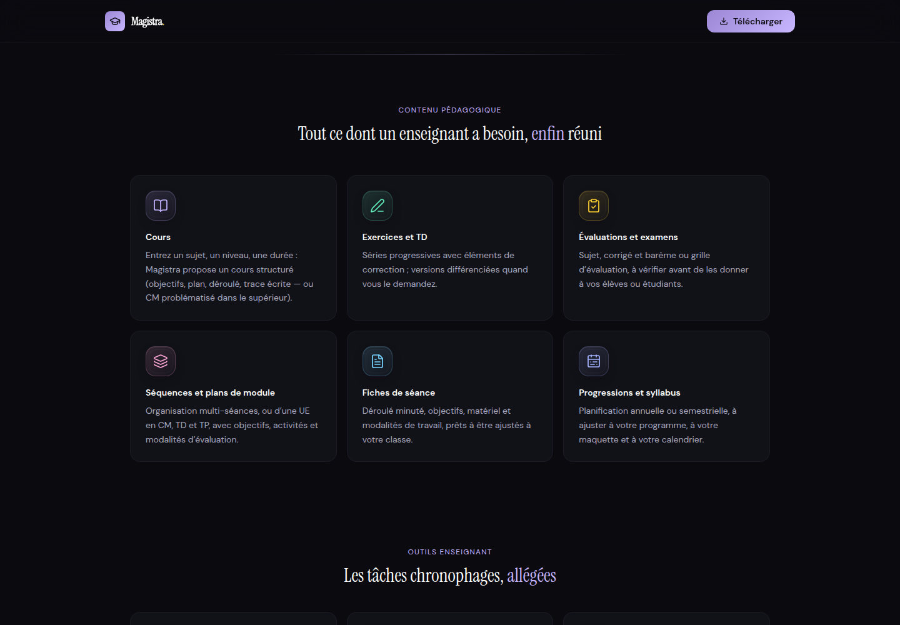
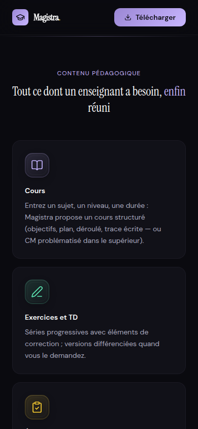

# Icônes et vérification de sécurité — 3 octobre 2026

Revue initiale effectuée sur `e398d3000344d41debf94fb8ff475c758db0b5b3`, tête de la branche d’intégration (PR #6) au moment de la vérification, avec les modifications d'icônes de cette branche.

Avant publication, les modifications ont été rebasées sans conflit sur `bedbd19c5f3429dd54a4f4c04acd866c6dc1fad9`, nouvelle tête de la branche d’intégration. Les changements d'origines officielles et d'ouverture des liens externes ont été relus ; les builds et les tests ci-dessous ont été relancés sur cette version synchronisée. Le verrou de dépendances n'a pas changé.

## Rendu

Les 17 symboles et émojis des cartes d'accueil deviennent des pictogrammes SVG Lucide. Les 11 outils partagent leur symbole et leur couleur avec l'application. Le composant `IconBadge` apporte un trait de 1,7, un fond teinté, un contour fin et un léger relief ; il est aussi utilisé par les outils rapides et l'en-tête de génération.

Le symbole de bienvenue du tableau de bord est également un SVG : son affichage ne dépend plus de la police d'émojis du système.

Les pictogrammes sont décoratifs, accompagnés d'un libellé visible et retirés de l'arbre d'accessibilité. Le mouvement au survol est réservé aux appareils avec souris et désactivé lorsque la réduction des animations est demandée. Aucune dépendance n'est ajoutée.

Captures de l'aperçu local :





## Sécurité : résultats et périmètre

Cette vérification ciblée complète les protections déjà présentes dans la branche d’intégration. Elle associe lecture du code, tests locaux et interrogation du registre npm. Aucune nouvelle faille exploitable n'a été confirmée dans les chemins examinés ; les résultats ci-dessous ne constituent pas un audit exhaustif.

| Surface examinée | Contrôles vérifiés |
| --- | --- |
| Mode personnel du serveur | Écoute en boucle locale, jeton secret exigé, Host et Origin contrôlés, refus du mode personnel sur un serveur ouvert au réseau. |
| Serveur de développement et fichiers statiques | Dossier de données et jeton non servis par Vite ; confinement des chemins du serveur autonome. |
| Connecteur local | Origines autorisées, Host exact, appairage, signature HMAC du corps, nonces contre le rejeu, révocation et limites de réception. |
| Electron | Origine et fenêtre de l'émetteur IPC, politique de contenu, protocoles des liens externes. |
| Sources web et contenu généré | Refus des adresses privées/locales et contrôle des redirections dans `safeFetch` ; HTML brut ignoré, liens dangereux neutralisés et KaTeX sans confiance accordée au contenu. |
| Site vitrine | Build isolé de l'application, sans authentification ni sondage du connecteur local ; tests de requêtes, stockage et liens. |

### Point de suivi : chaîne de fabrication Windows

`npm audit --json` remonte **8 entrées de gravité high**, provenant d'un **même avis** : [GHSA-ch52-4w7c-c8xp / CVE-2026-93748](https://github.com/advisories/GHSA-ch52-4w7c-c8xp), sur `http-cache-semantics` jusqu'à 4.2.0. L'avis ne donne aucune version corrigée au 3 octobre 2026.

Chaîne observée dans le verrou de dépendances :

```text
electron-builder 26.15.3
  app-builder-lib 26.15.3
    @electron/get 3.1.0
      got 11.8.6
        cacheable-request 7.0.4
          http-cache-semantics 4.2.0
```

L'avis concerne la réutilisation de réponses d'un cache HTTP partagé. Ici, le paquet est amené par le téléchargement d'Electron pendant la fabrication de l'installateur. Dans le code installé examiné, le cache HTTP de `got` reste désactivé par défaut ; aucun réglage du dépôt ne l'active. Ce constat réduit l'exposition de cet usage, sans supprimer l'avis du registre.

- `npm audit --omit=dev --json` : **0 alerte** sur les dépendances de production.
- `node scripts/audit-electron.mjs` : **aucun avis high ou critical sur le paquet Electron lui-même** ; 4 avertissements agrégés sur les outils de fabrication.
- Le script séparé est nécessaire : Electron est déclaré en `devDependencies`, bien que son moteur soit livré dans l'application Windows.

Le verrou de dépendances est conservé. Le retour automatique vers `electron-builder` 26.5.0 proposé par npm n'est pas appliqué : il remplacerait l'outil actuel par une version plus ancienne sans apporter de version corrigée de `http-cache-semantics`. Suivi recommandé : mettre à jour la chaîne de fabrication dès qu'une correction compatible est publiée, puis vérifier à nouveau l'empaquetage Windows.

## Vérifications exécutées

| Vérification | Résultat |
| --- | --- |
| TypeScript et ESLint | Réussite. |
| `npm run build:site` et `npm run verify:site` | Réussite ; aucune importation de code applicatif, sourcemap ou script en ligne dans le site. |
| `npm run build` | Réussite. |
| 20 fichiers de tests ciblés sécurité, site, domaine officiel, tableau de bord et sélection des outils | **515 tests réussis**. |
| `npx playwright test --project=site` | **26 scénarios réussis**, dont affichage mobile, navigation clavier, liens accessibles, référencement du nouveau domaine et absence de requêtes externes inattendues. |
| Contrôle visuel Chromium | Cartes d'accueil vérifiées à 1440 et 390 px ; pictogrammes lisibles et absence de débordement horizontal. |

Commande des tests ciblés :

```sh
npx vitest run tests/server/personal.test.ts tests/server/auth.test.ts tests/server/safeFetch.test.ts tests/server/devServer.test.ts tests/server/standalone.test.ts tests/electron/security.test.ts tests/electron/connectorServer.test.ts tests/electron/connectorCrypto.test.ts tests/electron/connectorPairing.test.ts tests/markdown/MarkdownView.test.tsx tests/site tests/shared/site.test.ts tests/ui/dashboard.test.tsx tests/ui/generateTools.test.tsx
```

Limites : exécution locale sous Linux avec Chromium ; aucun test d'intrusion sur la production, aucune inspection d'un installateur Windows fabriqué pendant cette revue, aucune vérification des secrets ou des réglages privés de Vercel. Les API externes des scénarios navigateur sont simulées par les fixtures du dépôt.
